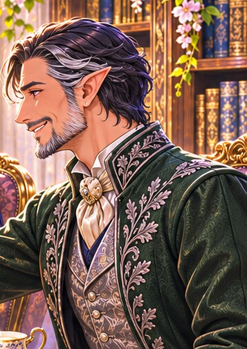

# Queen Daysha’s father

**First canonical on-screen appearance:** *Sunny royal elven family breakfast*. The creator designated this illustration as his visual reference. He is the nobleman seated at the far right, visiting the palace with his wife after arriving late the previous night. His earlier conversation with Daysha, her mother and King Rome took place by sending crystal, with only his voice present.

For future depictions, match the portrait: mature elven features, long pointed ears, swept-back dark hair with prominent silver at the temples and sideburns, strong dark brows, and a neatly trimmed salt-and-pepper beard and moustache. The breakfast illustration governs the facial hair despite the breakfast dialogue about shaving. His first-appearance outfit is a forest-green nobleman’s coat with silver foliate embroidery, an ivory cravat and a gold brooch. He is Queen Daysha’s father, her mother’s husband, and King Rome’s father-in-law. He knows court etiquette and is still getting used to addressing his son-in-law as king.

[Original full breakfast illustration](https://chatgpt.com/library?file_id=libfile_ae211ade305881918430bb01ba679d1e&account_id=personal)
